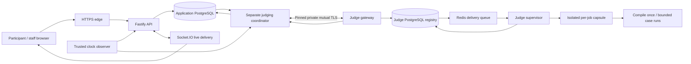

# Architecture

This is the implementation map for the completed Ingenium competition. The large original design is preserved in [the historical specification](docs/history/architecture-original.md); proposals in that document do not imply that every target was delivered.

## Services and trust boundaries

The API never compiles participant code in its own process. Judge services use separate users, credentials and a private network boundary. Redis delivers work; durable PostgreSQL records own admission, launch identity, verdict evidence and financial outcomes.

## One submission

1. A participant session identifies the team/member, round and locked language. Admission checks the current arena, clock, pauses, question availability, rate limits and unresolved work.
2. One transaction stores the original UTF-8 program and request receipt, freezes the snapshot/runtime/cases and assistance tier, and creates judging work. It also writes the live notification.
3. The coordinator owns a bounded lease and physical slots. A request to the private gateway binds exact source/input/runtime/limits and unique identities; transport uncertainty is recovered with the original lookup.
4. The judge registry and atomic launch permit prevent duplicate execution. A qualified capsule compiles once for a participant batch and runs all required cases with the frozen limits. Result bytes and later cleanup proof have separate identities.
5. Reliable evidence is checked against the original binding. The application checker determines the case outcomes and settles the competition once. Infrastructure uncertainty remains distinct from an incorrect solution.
6. Scores, wallets, penalties, claims and outbox updates commit with source-linked records. Reconnection fetches committed projections; a browser animation or local response never grants points.

See [participant judging](docs/participant-judging.md), [judge protocol](docs/judge-protocol.md), [batching](docs/judge-batching-handover.md) and [live delivery](docs/realtime.md).

## Competition state

An arena owns two rounds. Draft setup selects teams, duration and published snapshots; ready/start operations bind their revisions. Running/paused rounds accept guarded actions; closing drains admitted work before final results. Cancellation and restoration have explicit quarantine/recovery paths.

Round 1 credits each team's valid solve once. Round 2 normally awards the earliest eligible correct server-received official submission globally, with specific Claim Lock exceptions. Teammates share wallets, hints and items. Incorrect official Round 2 solutions add ranking time; samples and infrastructure failures do not.

The browser workbench keeps drafts and receipts; immutable source/verdict records preserve auditing. Lost responses recover the same receipt rather than resubmitting code or charging again. Financial values use integers and append-only ledger sources.

## Content and data

Authoring freezes a version into a snapshot. References and original starter-failure witnesses must pass the protected validation/publication flow before selection. Local compiler results are useful authoring evidence, not a substitute for that flow. Authoring validation is blocked while a competition is active.

The normal pre-start question limits are 50 for Round 1 and 100 for Round 2. Migration 0094 and matching local source add a separate append-only Round 2 action: up to 20 already-published questions per release, 120 total, with exact transaction receipts and revision checks. It does not edit the original selected questions or clock. This feature was not deployed during this work.

Application migrations and role grants are in `apps/api/drizzle/` and `infra/postgres/`. Judge registry migrations are a separate chain under `infra/judge-gateway/`. Never interchange the databases or reset historical permits to install a change.

## Reliability and operations

Trusted time, authenticated transport, immutable runtime/host proofs, once-only launch gates, positive cleanup evidence, restricted database roles, backup/restore quarantine and retention are part of the design. Tests distinguish synthetic observations from real compiler/kernel checks. Read [project status](docs/project-status.md) for measured boundaries and [testing](docs/testing.md) for the checks required after a relevant change.
